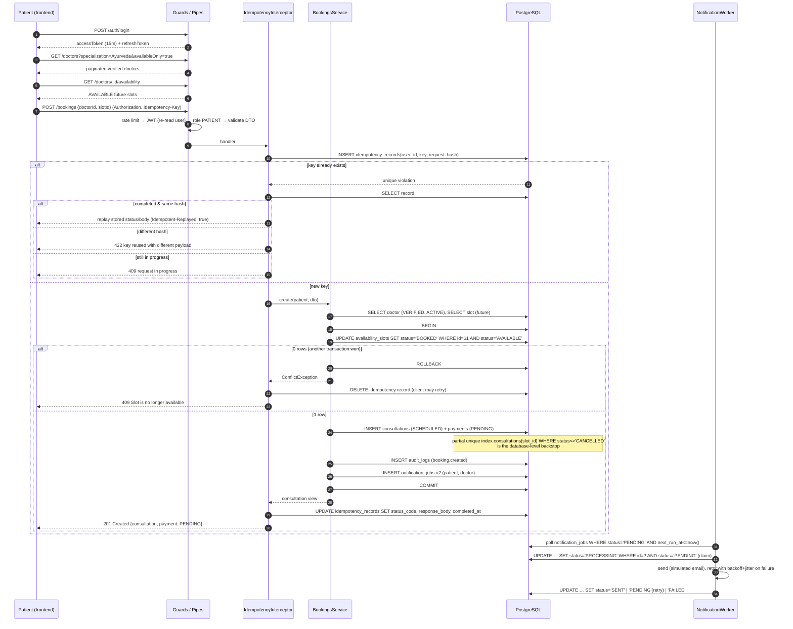

# Booking sequence

## Rules

| Topic | Rule |
|---|---|
| Transaction boundary | From the slot `UPDATE` to the notification inserts: one PostgreSQL transaction, `READ COMMITTED`. |
| Concurrency | Row lock on the slot serialises writers; loser matches zero rows → 409. Partial unique index on `consultations.slot_id` is the backstop. |
| Rollback | Any exception inside the callback rolls back all rows. Nothing partial can be observed. |
| Retries (server) | None for booking; it is not idempotent at the SQL level. |
| Retries (client) | Reuse the **same** `Idempotency-Key`. Same payload → replay; different payload → 422. |
| Idempotency retention | `IDEMPOTENCY_TTL_HOURS` (default 24 h); expired records are swept by the worker and ignored if hit. |
| Failed requests | Release the key so a retry re-executes (the failure itself is not cached). |
| Payment | A `payments` row (PENDING) is created with the booking. The patient then calls `POST /payments/intents`; settlement arrives via Stripe webhook or the mock endpoint. |
| Consultation start | Requires `payment.status = SUCCEEDED`. |

## Cancellation

`POST /bookings/:id/cancel` (patient, doctor, admin):

1. Validate access and that the state machine allows `SCHEDULED → CANCELLED`.
2. Transaction: conditional update to `CANCELLED`, release slot to `AVAILABLE` (if still in the future),
   audit row, notification job for the other party.
3. After commit: refund a `SUCCEEDED` payment through the provider (idempotency key `refund_<paymentId>`),
   or void a `PENDING`/`PROCESSING` one. Failures are logged for manual follow-up; the consultation
   stays cancelled (see "Sagas" in `architecture.md`).
