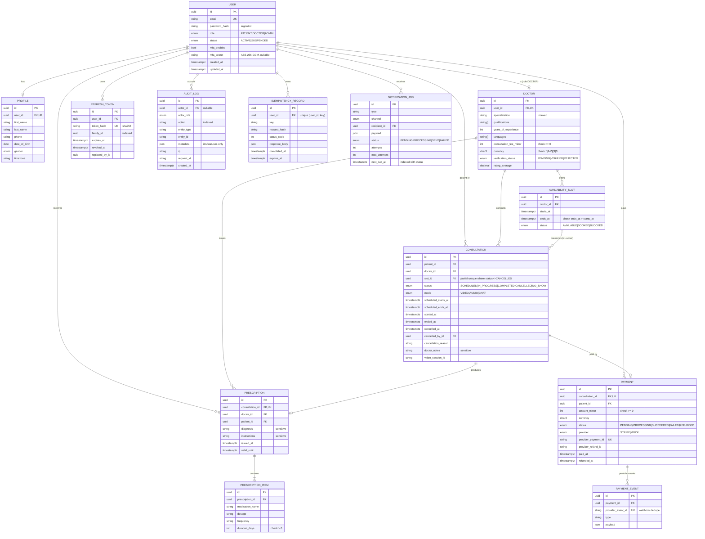

# Entity relationship diagram

## Important constraints and indexes

| Constraint | Purpose |
|---|---|
| `users.email` UNIQUE (stored lower-case) | One account per email |
| `refresh_tokens.token_hash` UNIQUE | Only hashes are stored; lookup by hash |
| `availability_slots (doctor_id, starts_at)` UNIQUE | No duplicate slot start per doctor |
| `availability_slots` CHECK `ends_at > starts_at` | Valid intervals |
| `consultations_active_slot_unique` — UNIQUE `(slot_id) WHERE status <> 'CANCELLED'` | **At most one live consultation per slot** (database-level double-booking guard); cancelled ones release the slot |
| `consultations` CHECK `scheduled_ends_at > scheduled_starts_at` | Valid intervals |
| `prescriptions.consultation_id` UNIQUE | One prescription per consultation |
| `payments.consultation_id` UNIQUE | One payment per consultation |
| `payments.provider_payment_id` UNIQUE | A Stripe PaymentIntent maps to one payment |
| `payment_events.provider_event_id` UNIQUE | Webhook idempotency |
| `idempotency_records (user_id, key)` UNIQUE | Request idempotency |
| `doctors`/`payments` CHECK fee/amount ≥ 0, currency `^[A-Z]{3}$` | Money sanity |
| `prescription_items` CHECK `duration_days > 0` | |

Hot-path indexes: `doctors(verification_status, specialization)`, `doctors(consultation_fee_minor)`,
`availability_slots(doctor_id, status, starts_at)`, `availability_slots(status, starts_at)`,
`consultations(patient_id, status, scheduled_starts_at)`, `consultations(doctor_id, status, scheduled_starts_at)`,
`consultations(status, scheduled_starts_at)`, `payments(status, created_at)`, `audit_logs(action, created_at)`,
`audit_logs(entity_type, entity_id)`, `notification_jobs(status, next_run_at)`, `idempotency_records(expires_at)`.

## Delete behaviour

- `User` → `Profile`, `RefreshToken`, `IdempotencyRecord`, `NotificationJob`: **cascade** (account removal).
- `User`/`Doctor`/`Slot` → `Consultation`, `Prescription`, `Payment`: **restrict** (medical and financial
  records are never silently deleted; accounts are suspended instead).
- `AuditLog.actor_id`, `PaymentEvent.payment_id`, `Consultation.cancelled_by_id`: **set null** (the trail
  survives the actor).

## Data types

- All primary keys: UUID generated in the database (`gen_random_uuid()`).
- Money: integer **minor units** (`amount_minor`, `consultation_fee_minor`) + ISO 4217 code; no floats.
- Timestamps: `timestamptz(3)`, stored in UTC; clients send ISO 8601 with offset, user timezone kept in
  `profiles.timezone` for display only.
- Sensitive columns (`password_hash`, `mfa_secret`, `doctor_notes`, prescription contents) are never
  logged and never included in audit metadata.
